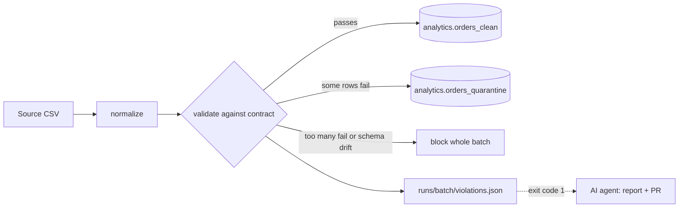

# data-contract-sentinel

A contract-first data pipeline guard. A written data contract defines what correct data looks like. Deterministic validation enforces it before anything reaches the warehouse. When a rule fails, bad rows are quarantined, run artifacts are written, and an AI agent investigates, writes an incident report, and opens a GitHub pull request.

**The contract enforces. The agent investigates and proposes. A human decides.**

## How it works



Both halves are built and tested. The agent has not yet been run live against a real model in this repo, so the OpenAI client is verified against a stub only.

## Quickstart

```bash
pip install -e ".[dev]"          # add ",snowflake" for the Snowflake adapter
pytest                           # 125 tests

# Ready-made samples live in samples/. To regenerate them elsewhere:
contractsentinel make-sample --out data/landing

contractsentinel run samples/orders_2026-10-01.csv    # clean: exit code 0
contractsentinel run samples/orders_2026-10-02.csv    # defective: exit code 1
contractsentinel run samples/orders_2026-10-02.csv --dry-run   # validate only
contractsentinel summarize                            # Markdown summary of everything in runs/
```

The defective batch has seven bad rows out of forty: two empty customer IDs, a wrong date format, text in `amount`, a negative amount, a mistyped status with an unknown region, and a duplicate order ID. Under the default policy, 33 rows load and 7 are quarantined with the exact rules they broke and the raw values the source sent.

## GitHub Actions

| Workflow | When | What it does |
|---|---|---|
| `ci.yml` | push to `main`, pull requests | Runs the tests on Python 3.11 and 3.13 |
| `pipeline.yml` | manual dispatch, or CSVs pushed to `landing/` | Runs the pipeline, uploads `runs/` as an artifact, writes a job summary, and exposes a `violations` output |

A contract violation does not fail the pipeline job. It sets `violations=true`, which is the trigger for the agent job. A tool error (exit code 2) does fail the job. The DuckDB file is ephemeral in Actions, so each run starts with an empty warehouse; point at Snowflake for persistence.

The full trigger table, root-cause classes, and guardrails are in [docs/workflow.md](docs/workflow.md).

## The contract

`contracts/orders.yaml` is the single source of truth. Per field it supports:

| Key | Meaning |
|---|---|
| `type` | `string`, `integer`, `decimal`, `date` |
| `nullable` | whether null is allowed (`source.null_tokens` defines null) |
| `unique` | unique within the batch |
| `pattern` | regex the whole value must match (strings) |
| `allowed` | list of permitted values (strings) |
| `format` | `strptime` format, checked strictly (dates) |
| `scale` | maximum decimal places, so values are never silently rounded |
| `min`, `max` | numeric bounds |

Contract files are validated on load. Table and column names are restricted to safe identifiers because they end up in SQL.

### Failure policy

```yaml
failure_policy:
  mode: quarantine          # or block_batch
  max_violation_rate: 0.20
```

- `quarantine`: valid rows load, invalid rows go to the quarantine table. If more than `max_violation_rate` of rows are invalid, the whole batch is blocked, because the source is probably broken.
- `block_batch`: any violation blocks the whole batch.
- Schema drift (a missing required column) or an empty file always blocks the batch.
- An unexpected extra column is a warning only; the column is dropped.

Batches are idempotent. Re-running a batch replaces that batch's rows in both tables, so a corrected file can be resent under the same name.

## Exit codes

| Code | Meaning |
|---|---|
| 0 | batch passed the contract |
| 1 | contract violated, which is the agent's trigger |
| 2 | the tool itself failed (bad contract, missing file, connection error) |

## Run artifacts

Each run writes `runs/<batch_id>/summary.json` (decision, counts, file SHA-256, contract version) and `violations.json` (every failed rule with counts and sample rows). These are the audit trail and the agent's input.

## Warehouses

- **DuckDB** (default): local, free, no setup. `--db data/warehouse.duckdb`.
- **Snowflake**: `--warehouse snowflake`. Configure through environment variables listed in `.env.example`. Key-pair auth is supported and preferred.

Adapters implement a small interface (`ensure_tables`, `replace_batch_clean`, `replace_batch_quarantine`, `count_rows`), so adding another warehouse means one new file.

## LLM layer

The agent only talks to a provider-neutral interface in `contractsentinel/llm/`. OpenAI is the default provider:

```bash
export OPENAI_API_KEY=...
export OPENAI_MODEL=...      # pick a tool-calling model; defaults to gpt-5-mini
```

`OPENAI_BASE_URL` points the same client at any OpenAI-compatible endpoint, such as a local Ollama server. Other providers can be added by implementing `LLMClient` and calling `register_provider`. `ScriptedLLMClient` replays canned responses so the agent loop can be tested without network access or spend.

## Investigation agent

When the pipeline exits with code 1, the `agent` job in `pipeline.yml` runs `contractsentinel investigate`. It reads the run artifacts, lets the model inspect the code and git history with read-only tools, and files the result:

- **Pull request**, when the model proposes an exact fix, the fix passes validation, and the full test suite passes on a throwaway branch.
- **Issue**, in every other case (source defects, no fix, failing tests, no LLM, LLM errors).

Try it without GitHub or a model: `contractsentinel investigate --runs runs --dry-run --no-llm`.

One-time repository setup for the workflow:

1. Settings > Actions > General > Workflow permissions: enable **Allow GitHub Actions to create and approve pull requests** (without it the agent falls back to an Issue).
2. Settings > Secrets and variables > Actions: add the secret `OPENAI_API_KEY`. Optional variables: `OPENAI_MODEL`, `OPENAI_BASE_URL`, `LLM_PROVIDER`. With no key the agent still files a deterministic report.

PRs opened with the workflow token do not trigger CI automatically; push an empty commit or close and reopen the PR. See `docs/workflow.md` for the guardrails.

## Layout

```
contracts/orders.yaml          the contract
samples/                       a clean and a defective sample batch (synthetic)
landing/                       drop batch CSVs here to trigger the pipeline workflow
docs/workflow.md               trigger table, root causes, guardrails
.github/workflows/             ci.yml, pipeline.yml
src/contractsentinel/
  contract.py                  load and validate the contract file
  validator.py                 deterministic rules -> violations
  transform.py                 normalize + typed casts (the pipeline code the agent will read)
  pipeline.py                  validate, decide, load, write artifacts
  adapters/                    DuckDB and Snowflake
  llm/                         provider-neutral types, OpenAI client, factory, scripted client
  summary.py                   Markdown run summaries (used in Actions)
  agent/                       tools, loop, schema, fixes, report, GitHub client, orchestration
  cli.py                       contractsentinel make-sample | run | summarize | investigate
tests/                         see `pytest`
```

## Status and roadmap

- [x] Contract, validator, quarantine, run artifacts
- [x] DuckDB and Snowflake adapters
- [x] LLM provider interface with OpenAI client
- [x] GitHub Actions: CI and a pipeline workflow that exposes a `violations` output
- [x] Investigation agent: read-only tools, bounded loop, incident report (Issue when there is no code fix)
- [x] PR creation with guardrails (tests must pass, never merges, human review required)
- [ ] Eval set of broken-batch scenarios to pick the cheapest model that passes
- [ ] Demo: a "harmless" commit breaks date handling, a bad batch arrives, the agent finds the commit

## Known limits

- The Snowflake adapter is tested against a fake connection that checks the SQL and transactions. It has not been run against a live account.
- The OpenAI client is tested against a stub of the SDK, not the live API.
- Uniqueness is checked within a batch, not against rows already in the warehouse.
- `violations.json` contains sample values from the source. Redact sensitive columns before any of it is sent to an LLM.
- Changing a field's type in the contract does not migrate an existing table.
